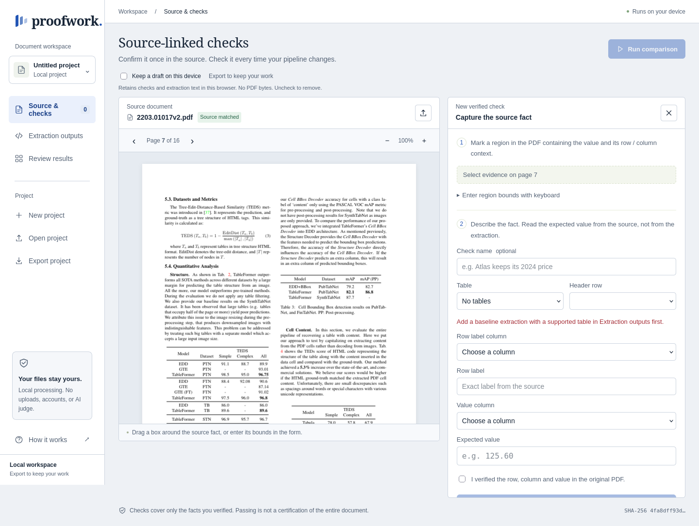
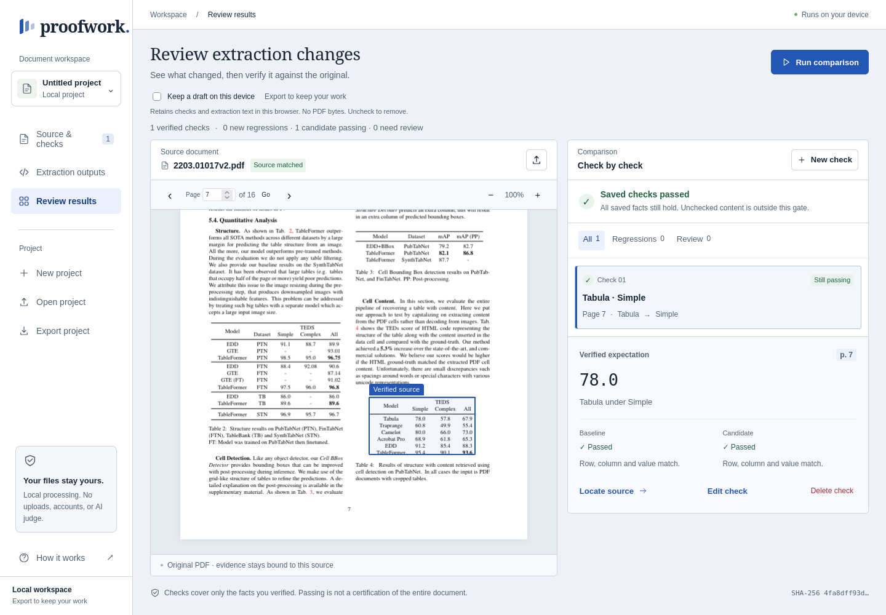
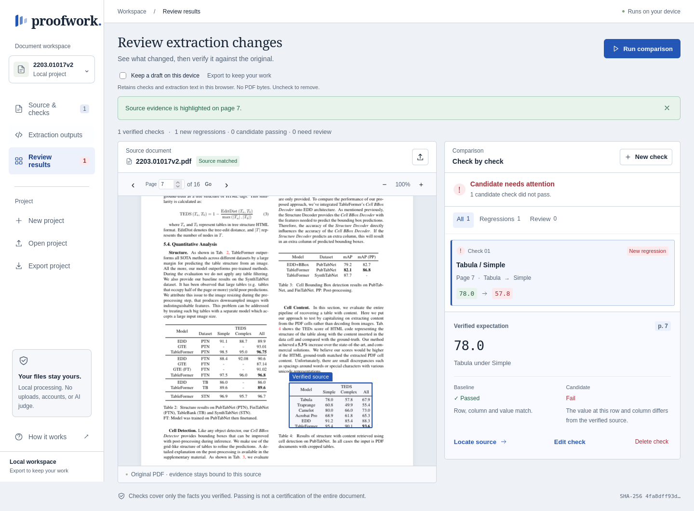

# Real-World Validation Report — Proofwork

日期：2026-10-11 UTC。最终决策：**PARTIAL**。支持范围内的严格事实检查通过本次验证，但真实复杂输入的工作流程覆盖率 **6/8 = 75%**，没有达到测试前固定的 **80%** 门槛。安全拒绝不能算事实验证成功，更不能算 PDF 提取准确。

测试过的最终产品提交：`044572f32244025058d8ad5d6b4dfd1376fdcb31`。较早的功能修复提交为 `f83be58326563b3be1ceba6ee0cb88cfefbcb65f`；原版源码为 `6837657`，预注册记录在首次执行前提交为 `39c776d`。最终 [Pages 部署成功](https://github.com/Georgefifth/proofwork/actions/runs/38114075693)，并在公开站点重新操作完整素材集，确认实际资源 `index-DWlERpwO.js` / `index-vDOivpWq.css`。

[公开产品](https://georgefifth.github.io/proofwork/) · [GitHub](https://github.com/Georgefifth/proofwork) · [机器可读总评](results/SUMMARY.json) · [逐例 CSV](results/cases.csv) · [素材来源和权利](SOURCES.md)

## 1. 目标、输入和能力范围

目标用户是维护文档提取流水线的开发者、数据质量人员。任务是把在原始 PDF 中确认的**某个表格事实**保存为源绑定合同，并判断下一版 Markdown / HTML 输出是否仍满足该事实。正常流程为：附加 PDF → 上传两份输出 → 找到原页、圈定证据 → 指定表格序号/表头行/行标签列/行标签/值列/源值 → 明确确认 → 保存 → 比较 → 导出或 CI。

这是确定性表格回归检查器，不从 PDF 自动提取事实，也不进行 OCR、全文理解或模型评分。仅检查保存的事实，PDF 哈希证明源身份，不能证明任意候选文本确实由该 PDF 生成。数字精度、符号、单位和标点保留；只规范空白和 Unicode NFC。重复选择的列或行必须复核。表格序号固定；无语义表格匹配，也没有复合行键。

浏览器上传 PDF 上限 50 MB；输出上传界面上限 5 MB；解析限制 100 表、每表 2,000 行、1,000 合同。CLI 文本上限按 JavaScript 字符串长度判断，与上传的字节检查并不完全等价；此次超限测试使用 ASCII，没有验证超长 Unicode 的字节边界。JSON 导出包含提取文本/合同/源哈希/证据坐标，不包含 PDF。浏览器无后端；Pages 可以支持现有本地处理，不提供数据库或服务器执行。

已实现：PDF 渲染、源绑定、证据、Markdown/HTML 表格解析、严格比较、导入导出、设备草稿、CLI。未实现：OCR、自动事实发现、表格语义定位、多字段行键、自动修复提取结果。既有单元/浏览器测试主要是合成 catalogue；本次提供外部素材证据，未把原有 60 个浏览器场景算作真实数据准确性。

## 2. 真实素材与独立参考

15 份外部 PDF：**13 份真实公开文档 + 2 份外部生成/脱敏 fixture**。真实文档由 8 份可核对表格文档、4 份负例、1 份大型官方年鉴构成。覆盖 1–940 页，真实科研论文、财报、技术手册、期刊、多栏文章、历史扫描、问卷；最大 31,959,786 字节。全部下载成功，没有因处理困难而删除样本。

固定了 Docling 和 olmOCR 的完整 Git 提交，使用未经改写的原始 pipeline Markdown。所有下载 URL、时间、大小、SHA-256 见 [manifest](manifest.json)；逐份许可、限制、用途和参考可信度见 [SOURCES.md](SOURCES.md)。代码 MIT/Apache-2.0 不自动授权第三方 PDF。原文件、全文输出和不确定权利的截图未提交公共仓库。TableFormer 截图按 CC BY 4.0 注明来源。

15 个选中事实的难度为 Basic 3 / Intermediate 5 / Advanced 6 / Edge 1。另有 4 个无已填表格事实的负例、2 个外部合成 fixture、年鉴性能样本。这些分层会重叠，但 PDF 总数不重复计数。负例验证的是渲染与没有自动制造已验证事实，不是不存在的“扫描器阴性识别率”。

参考值由本次评估助手视觉读取原始页图，并与部分上游结构数据交叉核对。未让产品输出评价自身，也未把上游 `groundtruth` 文件名当作真值。没有第二名人类标注者独立复核；一次参考定义错误说明仍有标注风险。无可靠参考的正文、公式、扫描文字识别不评分。

预先保留 OTSL 论文与历史小页扫描为两个独立文档：修复前只核对原页，未执行其产品结果；修复完成后首次运行。两份保留样本未用于调整解析器或判定规则。

## 3. 预注册、评分与隔离

[PLAN.md](PLAN.md)、[oracle.json](oracle.json)、[manifest.json](manifest.json) 在产品执行前固定，校验值见 [FROZEN.sha256](FROZEN.sha256)，原件未改写。通过要求：可寻址且保持正确的事实通过；改值/删行/精度/符号/单位变化不通过；重复选中标签不静默通过；恢复失败输入后仍能继续。任何错误肯定是核心失败。整体 PASS 还要求至少 80% 的已核对表格文档能在不重写原生输出的情况下完成至少一个有用的检查。

真实原生输出与派生故障分层计分。88 个派生案例使用 8 个已核对事实，每个 11 种确定性变换：改值、精度、符号、单位、删行、重复行、重复头、错列、整表列顺序反转、空白、脚本作为数据。数值字段用于数值格式测试；文本字段的对应后缀/符号变换只是字符串变化，不能称为数值精度样本。每份具体候选的预期和哈希在执行前固定于 [SUPPLEMENT-FROZEN.json](SUPPLEMENT-FROZEN.json)。新增 3 个边界例的固定记录见 [EDGE-FROZEN.json](EDGE-FROZEN.json)。这些都是**真实内容派生的合成故障**，不是自然真实错误。

测试类别/预期状态/故障标签留在评估目录，不输入产品。产品只得到用户正常提供的 PDF、提取输出、已确认事实合同；没有训练模型或读取隐藏答案。原始运行包含全文，保留在忽略的 `runs/` 中；公共 `results/` 只发布判定、短原因、时间、哈希与统计。

## 4. 环境和方法

Linux x86_64，Node v26.7.0，Playwright 1.64.0，无头 Firefox。分别在 localhost 与 GitHub Pages 使用新浏览器 context：真实文件选择器上传；实际导航、选择表格/列、输入源值、确认、保存、运行比较、查看最终 gate、导出 JSON 并检查源哈希/页码/值。PDF 确认 canvas 渲染、错误状态和截图，跳转末页；代表性页面作视觉核对，未逐页检查 940 页内容。

CLI 从普通项目 JSON 调用公开 `cli/check.ts`，使用 `--candidate` 和 `--pdf`。核对状态、实际值、原因、退出码；Linux `/usr/bin/time` 记录每个隔离进程最大 RSS，另记录墙钟时间。CLI 耗时含启动、解析、PDF 哈希；没有与仅执行一个函数的基准代码直接比较速度。

浏览器记录页面异常、console error、失败请求和 POST。最终两端各 15 个源加载、6 个完整原生表格任务没有意外页面异常、失败请求或 POST；这证明所执行操作没有上传文档，不能等同于通用安全认证。

## 5. 首次失败、修复和参考勘误

| 问题 | 原版真实复现 | 原因 / 严重度 | 处理与验收 |
|---|---|---|---|
| Docling 原生表格无法检查 | 论文/手册/期刊显示 0 tables，无法建立检查；CLI 7 个正确事实被拒绝 | 分隔符强制 ≥3 个 `-`，不接受单个 `-`；解析错误，P1 | 按 [GFM 官方表格规范](https://github.github.io/gfm/#tables-extension-)接受一个或多个连字符；8 个原预注册可寻址事实全部正确通过，错值和重复项仍不通过 |
| 大文档不能快速定位 | Census 940 页只有前后按钮；末页理论需 939 次 Next，测试仅走到第 3 页，末页任务 Blocked | 导航设计，P2 | 页码输入 + Enter，两次操作完成末页定位；超范围输入不跳页，可修正后继续 |
| 窄屏页码栏换行 | 新页码栏的 `of 16` 在 390px 分成两行 | 视觉布局，P2 | 调整间距/宽度和不换行；本地/线上 320、390、768、1440px 加导航/缩放各 5 项通过，复看截图 |
| DocLayNet 参考定义不正确 | 冻结定义将 source 多层列当成 raw 输出中的重复 `11` | **测试参考错误，不是产品错误** | 原 PDF p7 需要多层列，但 native 输出已有 `Class-count - Split` / `11 - Doc` 等唯一名称；原冻结 FAIL 原样保留，单独 [勘误](ORACLE-ERRATUM.json)与 follow-up 正确通过；门槛未改变 |
| malformed / missing native headers | DiscoveryWorld 6 列表头对应 12 列数据；财报遗漏 2025 | 上游解析/结构错误 + 产品创建入口限制 | 正确阻断，没有自动修复。CLI 能提示缺列；UI 无法凭不存在的列创建新合同 |

首次 CLI：13 个开发层原始定义，4 个符合预期 / 9 个不符；其中一项定义后来确认有误，不能当作产品错误计分。修复后原冻结 CLI 原样结果为 46 PASS / 1 FAIL（包含 32 个早期派生例）；唯一剩余不符是该参考定义。早期派生的 baseline 和 candidate 都用了变换后的文本，因此只能证明 gate 判定，不能证明“新回归”分类。主评估以新的 88 例为准：baseline 固定原生输出，candidate 才变换，实际检查 regression/unchanged/review。32 例未叠加计算。

初始与最终结果分别保存于 [initial-cli](results/initial-cli.json)、[final-cli-raw](results/final-cli-raw.json)、[派生与勘误](results/derived-and-correction.json)。原始参考错误与新复测都有记录，没有覆盖初始失败。

## 6. 主要结果与真实能力边界

| 能力 / 分母 | Pass | Fail | Blocked / 无法判断 | 含义 |
|---|---:|---:|---|---|
| 原冻结可寻址且正确的事实 | 8/8 | 0 | 0 | 首次只有 1/8 通过；修复消除 7 个错误拒绝 |
| 勘误后的额外正确事实 | 1/1 | 0 | 原定义 1 项不可评分 | 保留原标签，未混作独立保留集成功 |
| 48 个错值/精度/符号/单位/删行/错列派生例 | 48/48 正确拒绝 | 0 错误肯定 | 0 | 基于真实内容的受控合成故障 |
| 16 个重复行/表头派生例 | 16/16 正确 ambiguous | 0 | 0 | 安全阻断，不算成功事实验证 |
| 8 个列重排 / 8 个空白 / 8 个脚本数据控制 | 24/24 | 0 | 0 | 字段保持不变时不错误拒绝；脚本未执行 |
| 表格全局重排、空候选、超长 ASCII | 3/3 达到预期 | 0 | 重排能力仍缺失 | 重排阻断是已知能力边界，不是语义匹配成功 |
| PDF 源加载与末页导航（最终本地 / 线上） | 各 15/15 | 0 | 0 | 仅渲染能力；2 个外部合成素材另计 |
| 本地 / 线上真实素材错误恢复 | 各 8/8 | 0 | 0 | 错列、恢复、错误 PDF、真实截断、超限、非法页码、移动端、导入回环 |
| 现有完整 QA 回归（本地 / 线上） | 各 30/30 | 0 | 0 | 合成/交互回归，不是真实数据准确性 |
| 新布局相关回归（本地 / 最终线上） | 各 5/5 | 0 | 0 | 最后 CSS 修改后的受影响覆盖 |
| 原生表格文档任务覆盖 | **6/8** | — | **2/8 无法完成** | **75% < 80%；整体 PARTIAL** |

自然原生的有效事实判定：8 个正确匹配 + 6 个安全非通过，共 14/14 符合参考；原定义错误一项 INCONCLUSIVE。另做勘误 follow-up，正确匹配。因此不能把它描述成原始 15/15 全部一次通过，也不能把安全拒绝折算成提取准确率。

8 个原生表格文档的任务结果：TableFormer、DocLayNet、IBM 手册、地理期刊、财报可完成正确事实检查；OTSL 可完成已存在提取错误的源值检查，显示 `0.965` 与 `0.965 0.969` 不同。这算完成有用检查，但不算输出正确。DiscoveryWorld 原生结构损坏、历史小页无表头，不能完成创建。排除保留集的同一 6 份文档，原版可用 1/6，修复后 5/6；加入独立保留文档后为 6/8。没有将难例删除来提高分数。

额外安全非通过中：TableFormer 重复 Model 和财报重复年份为 ambiguous；财报缺 2025 与 OTSL 合并值为 fail；DiscoveryWorld 为 unsupported；无表头页为 fail/missing table。只有 OTSL 明确返回错误源值；无表头拒绝不代表系统理解了历史数值。

所有当前分母都是本次目的性小样本，不是泛化准确率、真实用户成功率或满意度。未做 OCR 的漏识别统计、未核对公式识别、未评测自然 HTML 全集；不能从合成 HTML 回归推断所有真实 rowspan/colspan 文档可靠。

## 7. 与替代方案的公平比较

使用相同 native/派生文本和源事实，执行固定版本 [olmOCR 官方 TableTest](https://github.com/allenai/olmocr/blob/f7cfe4c22098b154c76b6ec950d1c0a464eecf8d/olmocr/bench/tests.py)，`max_diffs=0`、目标值与 top/left-heading 关系。无 OCR 模型执行；这是评分函数能力比较，不是提取器竞赛或整个 olmOCR-bench 官方得分。[逐例输出](results/benchmark.json)保留全部 104 个主比较任务（包含原参考错误及勘误 follow-up），不只展示等价组。

- 65 个条件相近的任务（9 个未变事实、8 个空白控制、48 个故障）判定一致，未发现能宣称全面优势的证据。
- 16 个重复标签例：TableTest 的语义是“存在一组符合关系的值”，因此返回 True；Proofwork 要求唯一，返回 ambiguous。不是把竞品按我方规则判错。
- 8 个列反转例：Proofwork 按命名列正常通过；TableTest 配置的 left_heading 在行标签被移到右侧后不等价，因此未计入公平胜负分数。
- 8 个脚本作为数据例：Markdown 中 HTML 的处理规则不同，结果保留、未计入同条件比较。
- **竞品更强的可验证能力**：同一历史 headerless 文本，TableTest 直接设置 `cell='20', left='Fatty matter'` 可通过；Proofwork 创建入口必须有命名表头，Blocked。此探针使用已公布的同一源事实，不改变主评估标准，说明关系断言更灵活。
- 弱参考“全文是否含有值”在 8 个错列例仍全部认为值存在；Proofwork 全部拒绝。它只用来说明文本存在不能代替行列关系，不是成熟竞品性能结论。

未用不同机器/模型/价格环境硬比响应速度或资源，也未绕过商业产品认证、付费或使用限制。

## 8. 性能与用户体验

CLI 自然 15 例单进程墙钟中位约 93.8ms，范围 80.7–120.2ms；本次 CLI 各例峰值 RSS 70,864–94,592 KiB（含 Node 与数据内存，不能当作纯算法占用）。没有测浏览器进程峰值 RSS，也没有 CPU 压力/并发/设备矩阵评估。

最终线上从选择源文件到首渲染确认中位 362ms，范围 253–987ms，不包括最初网页加载。940 页年鉴首渲染 987ms，输入末页后的跳转/渲染 130ms。每文档一次运行，不代表冷启动分位数、低端设备表现或用户读表耗时。

主要体验改进有直接证据：Docling 用户无需改写标准分隔符即可开始任务；Census 页码定位从结构上需要 939 次 Next，变成输入+Enter 两次操作，并实际显示末页。未测原版 939 次点击总耗时，不能虚构“节省百分之多少时间”。正常已验证事实与错误候选有清晰状态和源对照；失败后可以上传正确源或恢复 candidate 继续。

仍需改善：损坏表格缺乏可继续的创建入口；多字段身份需要更灵活合同；手机源表文字需要缩放/滚动查看，不能声称在窄屏同样高效。最终代表性截图未发现页级溢出或遮挡，但此视觉检查不构成 WCAG 认证，也没有虚构用户满意度。

## 9. 所有异常的归因与证据完整性

- 初次网页脚本的 exact 导航按钮名称漏掉动态计数，随后页码跳转函数误以为当前位置恒为 1，再有 label matcher 无法匹配 Table select：均为**测试工具错误**，不是产品失败。保留 `runs/initial-live-browser`、`initial-live-v2-browser`、`initial-live-v3-browser`；更正脚本后重新走同一输入，未降低业务断言。v3 里财报/DiscoveryWorld 的 authoring 异常由 [v4](results/initial-browser-harness-correction.json)补完。
- 首次超限 PDF 以 buffer 传给 Playwright 时，工具本身限制 50MB，未到达应用；保留 [初次记录](results/local-recovery-first.json)。改为真实文件路径后验证产品拒绝，属于恢复传输方式而非绕过功能。
- 首轮线上最终 corpus 一份脱敏 fixture 在导航时出现 `SSL_ERROR_UNKNOWN`，产品尚未加载，是外部访问失败：[原记录](results/live-browser-first.json)。未禁用 HTTPS 验证；最终新 context 重测全 15 份，全部成功，失败证据仍保留。
- 沙箱下第一轮 npm 测试的 CLI 子进程受环境限制；批准执行后真实 21 项均通过。构建成功，Pages Actions 也运行测试和构建成功。
- 早期 QA 配置的相对报告路径嵌套，线上运行覆盖了本地 QA 的详细 JSON；保留本地真实控制台的 30/30 与 50.2s 观察统计，明确标记为摘要，不编造逐例时间。原始真实数据 CLI/浏览器初始结果始终未被覆盖。配置已改用绝对输出路径。

原始 PDF、输入、每例 stdout/stderr、资源、项目、参考页、截图均在 `validation/real-world/{downloads,reference,runs}/`。不确定权利的文件只在本机留存，公开文件只包含短结果。截图和 JSON 汇总见下方；未执行/无参考的能力明确标记未评估，不折算 Pass。

## 10. Demo 与产品宣传验收

**可以支持的展示**：真实 TableFormer/IBM/财报事实的源确认；旧/新输出的精确关系检查；真实 OTSL 合并值造成的 existing failure；严格保留精度/单位/符号；错误源绑定拒绝；940 页文档的证据定位。用于公开视频的原文素材应限于有明确再用权利的内容（本次 TableFormer CC BY 4.0 并标作者/来源），其他素材不要因公开下载就直接播出。

**不可支持的展示/措辞**：“自动阅读任意 PDF”“高准确率 OCR”“所有复杂表格都支持”“验证整份文档”“无漏报”“优于所有竞品”“真实用户满意度高”。本次结果不支撑这些宣传。

建议后续优先解决源中无表头/输出缺失表头的合同创建与复合行键，而非加入 AI、Dashboard 或自动修复。再以新的独立素材评估覆盖率；当前保留集已用于最终评估，未来针对它调试不能继续称独立。

## 11. 截图

下列截图来自真实浏览器操作。论文内容归 Ahmed Nassar、Nikolaos Livathinos、Maksym Lysak、Peter Staar，[TableFormer v2](https://arxiv.org/abs/2203.01017v2)，[CC BY 4.0](https://creativecommons.org/licenses/by/4.0/)。截图为原 PDF 在产品中的浏览器合成画面，未修改论文数值；源文件取自固定 Docling fixture。截图中的被变换输出明确属于故障测试，不是论文原文。

| 修复前不能识别原生输出 | 修复后真实事实通过 |
|---|---|
|  |  |



[移动端真实 PDF 与页码定位](screenshots/mobile.png)。其他失败状态、Census、OTSL 等截图因权利未确认，保留在本机 `runs/`，不在公共仓库重发布。

## 12. 可复现操作

在当前项目的新测试副本中操作，避免覆盖现有证据。安装项目依赖和 Firefox，确保 `python3`、`pdfinfo`、`pdftoppm`、`/usr/bin/time` 可用。不要重新运行原始 freeze/download 脚本来改写已提交的清单。

```sh
python3 validation/real-world/restore.py
# 校验在 validation/real-world 目录内执行：sha256sum -c FROZEN.sha256
python3 validation/real-world/prepare_refs.py
python3 validation/real-world/run_cli.py replay
# supplement/edges 拒绝覆盖已经存在的 runs 子目录；在新副本执行
python3 validation/real-world/supplement.py
python3 validation/real-world/edges.py
npm run dev
node validation/real-world/run_browser.mjs replay-local http://127.0.0.1:5173/
node validation/real-world/run_browser.mjs replay-live https://georgefifth.github.io/proofwork/
node validation/real-world/recovery.mjs https://georgefifth.github.io/proofwork/ replay
QA_PHASE=replay npx playwright test --config validation/real-world/regression.config.ts
```

官方纯表格基准使用隔离 venv（系统 BeautifulSoup + `rapidfuzz==3.14.3`），执行 `benchmark.py`。它默认读取本次固定 `runs/final` 与 `runs/supplement`；重放目录名不同应显式调整路径，不要将重放冒充首次结果。`restore.py` 验证所有 SHA-256，若公开源改变/失效则报告失败，不接受替换内容。重放不再是未见过的保留集验证。
